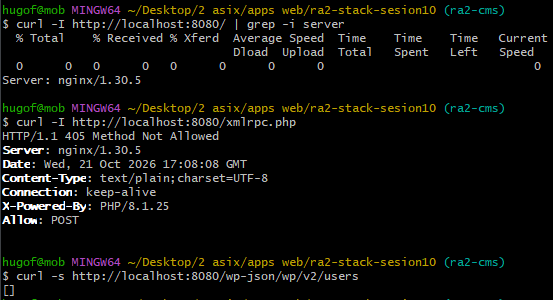
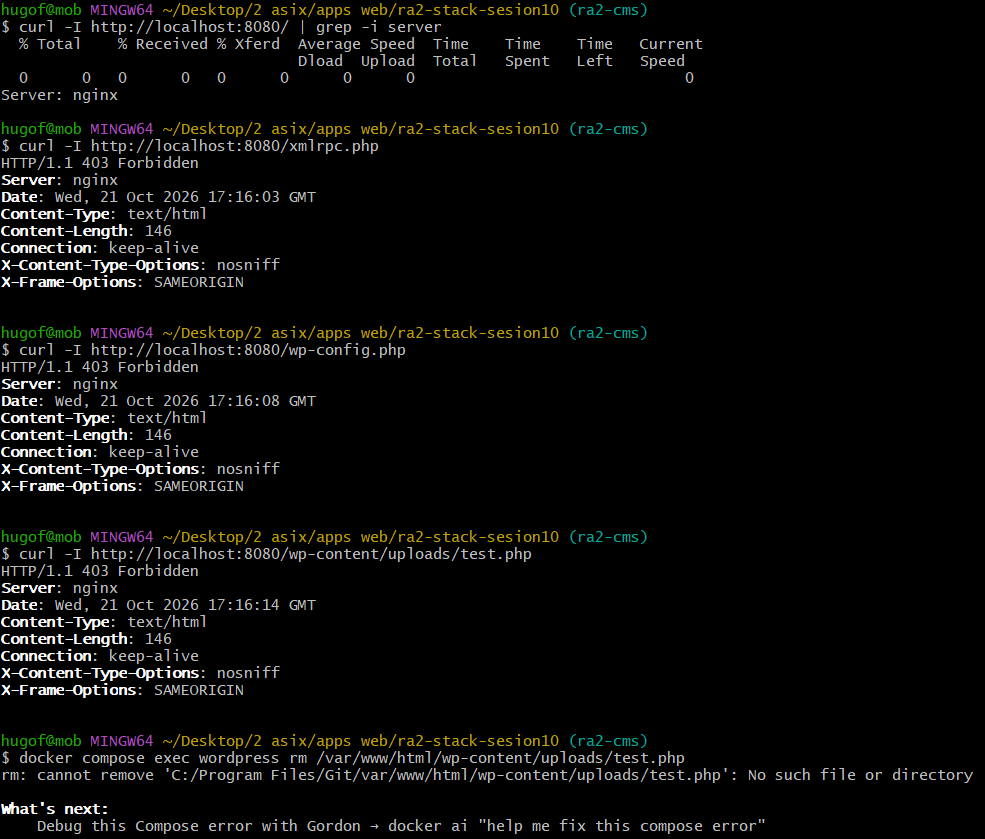

# Seguridad del gestor de contenidos (WordPress + Nginx)

| Comprobación | Antes | Después |
|---|---|---|
| Cabecera `Server` | Visible (`nginx/1.24.x`) | Oculta (`nginx`) |
| `/xmlrpc.php` | `200 OK` (expuesto a ataques) | `403 Forbidden` |
| `/wp-config.php` | Accesible / descargable si falla PHP | `403 Forbidden` |
| PHP en `/wp-content/uploads/` | Ejecuta código arbitrario | `403 Forbidden` |
| Edición de ficheros desde el panel | Habilitada (riesgo de webshell) | Deshabilitada (`DISALLOW_FILE_EDIT`) |
| Límite de intentos de login | Sin límite (fuerza bruta factible) | Bloqueo activo tras reintentos fallidos |
| Usuarios y privilegios | Un único usuario admin genérico | Separación de roles (editor/autor vs admin) |

---

## Medidas aplicadas, riesgos mitigados y sus límites

### 1. Directiva `server_tokens off;` y cabeceras de seguridad en Nginx
- **Medida:** Desactivación de la emisión del número de versión exacto del servidor web en las cabeceras de respuesta HTTP (`nginx/default.conf`) y adición de cabeceras de protección (`X-Content-Type-Options: nosniff`, `X-Frame-Options: SAMEORIGIN`).
- **Riesgo mitigado:**
  - Evita el escaneo automatizado y la identificación inmediata de vulnerabilidades conocidas (CVEs) asociadas a una versión específica de Nginx (reconocimiento pasivo).
  - Mitiga ataques de Clickjacking (`X-Frame-Options`) e interpretación incorrecta de tipos MIME (`X-Content-Type-Options`).
- **Límites:**
  - *Seguridad por oscuridad:* Un atacante avanzado aún puede identificar el software mediante técnicas de *fingerprinting* (comportamiento de respuestas ante peticiones anómalas).
  - No soluciona vulnerabilidades subyacentes del servidor si este no se mantiene actualizado.

### 2. Bloqueo de `xmlrpc.php`
- **Medida:** Regla `location = /xmlrpc.php { deny all; }` a nivel de servidor web.
- **Riesgo mitigado:**
  - `xmlrpc.php` es uno de los vectores más comunes para ataques de amplificación DDoS (mediante `pingback.ping`) y ataques de fuerza bruta masiva sobre credenciales de usuarios (mediante llamadas `system.multicall` que prueban cientos de combinaciones en una sola petición HTTP).
- **Límites:**
  - Bloquea servicios legítimos de terceros que dependen de la API XML-RPC (por ejemplo, sincronización con la app móvil nativa antigua de WordPress o plugins como Jetpack si no usan la REST API moderna).
  - No protege contra ataques dirigidos a la interfaz de login estándar `/wp-login.php` ni a la REST API `/wp-json/`.

### 3. Protección de `/wp-config.php` y archivos sensibles
- **Medida:** `location = /wp-config.php { deny all; }`.
- **Riesgo mitigado:**
  - En caso de una mala configuración del procesador FastCGI o fallo puntual del backend PHP, el archivo no se enviará en texto plano al cliente, impidiendo la filtración de credenciales críticas de la base de datos y claves de sal (`SALT_KEYS`).
- **Límites:**
  - Protege el acceso HTTP directo desde el exterior, pero no protege si un atacante consigue ejecución remota de código (RCE) o una vulnerabilidad LFI (*Local File Inclusion*) dentro del contenedor.

### 4. Restricción de ejecución de PHP en la carpeta de subidas (`uploads/`)
- **Medida:** `location ~* ^/wp-content/uploads/.*\.php$ { deny all; }`.
- **Riesgo mitigado:**
  - Previene la ejecución de *webshells* o código PHP malicioso camuflado que haya sido subido explotando alguna vulnerabilidad en plugins de carga de medios o formularios.
- **Límites:**
  - Solo protege la carpeta `uploads/`. No impide que un atacante intente escribir en otros directorios con permisos de escritura (como el directorio raíz de WordPress o directorios temporales `/tmp`) si existe una vulnerabilidad en el CMS.

### 5. Deshabilitación del editor de temas y plugins (`DISALLOW_FILE_EDIT`)
- **Medida:** `define('DISALLOW_FILE_EDIT', true);` inyectado mediante `WORDPRESS_CONFIG_EXTRA`.
- **Riesgo mitigado:**
  - Si las credenciales de un administrador se ven comprometidas, el atacante no puede modificar directamente el código PHP de los temas o plugins desde el panel de control web para inyectar puertas traseras.
- **Límites:**
  - Un administrador aún puede instalar o subir nuevos plugins o temas mediante archivos comprimidos `.zip` si no se desactiva también `DISALLOW_FILE_MODS`.
  - No protege si el atacante obtiene acceso al sistema de archivos mediante SSH, volumen Docker o FTP.

### 6. Límite de intentos de acceso y gestión de roles de usuario
- **Medida:** Control de reintentos de autenticación (bloqueo por IP y tiempo de espera tras intentos fallidos) y principio de menor privilegio en las cuentas de usuario (usuarios editores/autores para la publicación diaria sin privilegios de administración).
- **Riesgo mitigado:**
  - Dificulta ataques de diccionario y fuerza bruta contra `/wp-login.php`.
  - Limita el radio de impacto (*blast radius*) si una cuenta secundaria es vulnerada.
- **Límites:**
  - En entornos con proxy inverso o NAT compartida, un bloqueo por IP mal calibrado podría causar denegación de servicio a usuarios legítimos de la misma red de origen.
  - No sustituye la necesidad de autenticación de doble factor (2FA) ni de contraseñas robustas.

---

## Evidencias gráficas (Antes / Después)

- **Antes del endurecimiento:** 
- **Después del endurecimiento:** 
